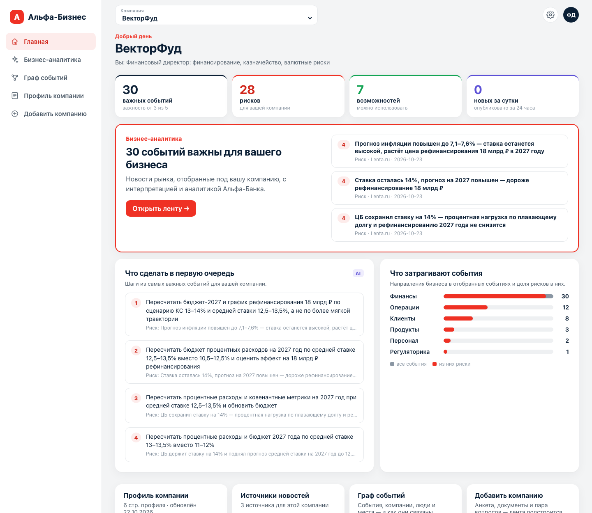

# Документация EventGraph

EventGraph — новостная аналитика для руководителей крупного бизнеса в
интернет-банке «Альфа-Бизнес». Сервис собирает новости и отчёты аналитиков
банка, раскладывает их в граф событий и для каждой компании-клиента
оценивает, насколько событие важно для её бизнеса, через какой механизм оно
влияет и что с этим делать.



Вся документация одним файлом Word, с оглавлением и скриншотами —
[EventGraph_documentation.docx](EventGraph_documentation.docx).

## Разделы

| документ | для кого | о чём |
|---|---|---|
| [Руководство пользователя](user-guide.md) | пользователь, тестировщик | все экраны интерфейса со скриншотами: главная, лента, карточка события, AI-сводка и чаты, источники, граф событий, профиль, добавление компании, настройки |
| [Сценарий: новая компания](demo-company/README.md) | тестировщик | пошаговое добавление компании `U_81081` с готовой анкетой, шестью файлами и ожидаемым результатом каждого шага |
| [Развёртывание и эксплуатация](deployment.md) | администратор | требования, запуск в Docker, ключи, модель LLM, переменные окружения, данные, обновление, мониторинг в Langfuse, неполадки |
| [Архитектура](architecture.md) | разработчик | части сервиса, путь записи от источника до ленты, агенты и их инструменты, граф, профиль, хранилище, трассируемость, безопасность |
| [API](api.md) | разработчик, интегратор | методы REST API с примерами `curl` |

## Быстрый старт

```bash
cp .env.example .env
```

В `.env` задайте `API_KEY` и ключ модели (`LLM_BASE_URL`, `LLM_API_KEY`,
`LLM_MODEL`), затем:

```bash
docker compose up -d --build
```

Интерфейс — `http://<сервер>:8765`, ключ входа:

```bash
docker compose logs profile-gui | grep 'ключ доступа'
```

Подробно — в [«Развёртывании»](deployment.md).

## Что посмотреть за 10 минут

1. Войти и выбрать в переключателе компанию **ВекторФуд** — главная покажет
   важные для неё события и первые шаги.
2. **Бизнес-аналитика** → открыть верхнюю карточку: механизм влияния с
   цифрами компании, позиция аналитиков банка, первоисточник.
3. Переключить компанию на **СибМеталл** — та же новость о ставке ЦБ
   оценена и объяснена иначе.
4. **Граф событий** → найти «Банк России»: связи, события, публикации.
5. **Добавить компанию** по [сценарию](demo-company/README.md).

Сторонние компоненты, модели и данные —
[THIRD_PARTY_NOTICES.md](../THIRD_PARTY_NOTICES.md).
