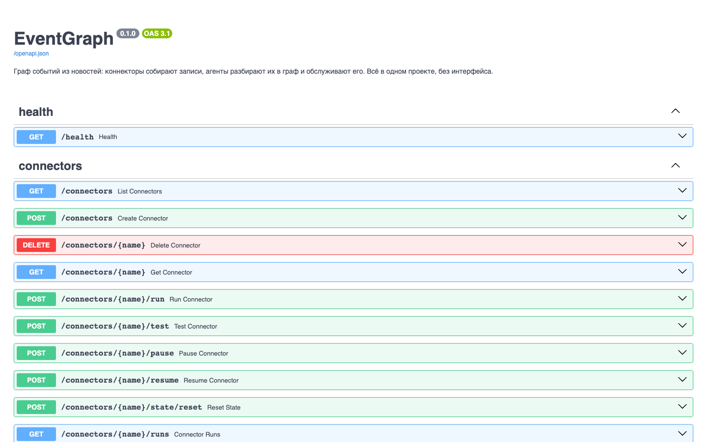

# API

REST API EventGraph — то же, чем пользуется интерфейс: источники, записи,
граф, раны агентов, профили компаний, лента и AI-функции. Интерактивное
описание всех методов со схемами — Swagger самого сервиса:
`http://<сервер>:8000/docs`, схема — `/openapi.json`.



- [Доступ](#доступ)
- [Состояние](#состояние)
- [Источники](#источники)
- [Записи](#записи)
- [Разбор и обслуживание графа](#разбор-и-обслуживание-графа)
- [Граф](#граф)
- [Агенты и раны](#агенты-и-раны)
- [Профили и лента](#профили-и-лента)
- [AI: сводки и чаты](#ai-сводки-и-чаты)

## Доступ

Все методы, кроме `/health`, требуют заголовок `X-Api-Key` со значением
`API_KEY` из `.env`. Без `API_KEY` API закрыт. Примеры ниже используют
переменную:

```bash
H="X-Api-Key: $(grep ^API_KEY .env | cut -d= -f2-)"
```

В граф через API не пишут: пишут только агенты, в воркере, одна запись за
другой.

## Состояние

| метод | путь | что |
|---|---|---|
| `GET` | `/health` | база, модель, эмбеддер, включённые агенты, имя графа; без ключа |

```bash
curl -s localhost:8000/health
```

```json
{"status": "ok", "db": true, "llm": true, "model": "deepseek-flash",
 "embedder": "local:sentence-transformers/paraphrase-multilingual-mpnet-base-v2",
 "embedder_remote": false, "agents": ["news", "gardener", "analyst"], "graph": "news"}
```

## Источники

| метод | путь | что |
|---|---|---|
| `GET` | `/connectors` · `/connectors/{name}` | источники: вид, расписание, курсор, последний запуск, число записей |
| `POST` | `/connectors` | свой источник: `kind` (`website`, `telegram_channel`), `target`, `title`, `interval_seconds` |
| `DELETE` | `/connectors/{name}` | удалить свой источник; собранные записи остаются |
| `POST` | `/connectors/{name}/run` | собрать сейчас |
| `POST` | `/connectors/{name}/test` | проба: что вернул бы сбор, без записи |
| `POST` | `/connectors/{name}/pause` · `/resume` | пауза расписания; ручной запуск остаётся |
| `POST` | `/connectors/{name}/state/reset` | сбросить курсор |
| `GET` | `/connectors/{name}/runs` · `/connector-runs/{id}` | история запусков |

```bash
curl -s -H "$H" localhost:8000/connectors | jq '.[] | {name, enabled, paused, last_status, items_count}'
```

```bash
curl -s -X POST -H "$H" localhost:8000/connectors/lenta_economics/run
```

## Записи

| метод | путь | что |
|---|---|---|
| `GET` | `/items` · `/items/{uid}` | собранные записи |
| `GET` | `/items/count` | сколько записей |
| `GET` | `/items/{uid}/images/{n}` | картинка записи |
| `DELETE` | `/items` · `/items/{uid}` | удалить записи |

## Разбор и обслуживание графа

| метод | путь | что |
|---|---|---|
| `GET` | `/graph/status` | очередь, запись в работе, пауза после сбоя (`paused_until`), последняя разобранная запись, срок обслуживания |
| `GET` `PUT` | `/graph/settings` | настройки разбора: `enabled` (пауза), `min_importance`, `item_images`, расписание и задачи садовника |
| `GET` | `/graph/processed` | последние разобранные записи: вердикт, событие или причина, ран, оценка (`?min_importance=4`) |
| `GET` | `/graph/stats` | динамика по дням |
| `POST` | `/graph/resume` | снять паузу после сбоя |
| `POST` | `/graph/requeue-failed` | вернуть в очередь записи `failed` |
| `POST` | `/graph/requeue-below-threshold` | вернуть записи, закрытые порогом важности: после снижения порога или добавления компании |
| `POST` | `/graph/maintain` · `/graph/maintain/stop` | обслуживание сейчас / остановить после текущей задачи |
| `GET` | `/graph/maintenance` · `/graph/maintenance/{id}` | прогоны садовника, их задачи и решения |

```bash
curl -s -H "$H" localhost:8000/graph/status | jq '{queue, working, paused_until}'
```

Поставить порог важности 2 и вернуть закрытые им записи:

```bash
curl -s -X PUT -H "$H" -H 'Content-Type: application/json' -d '{"min_importance": 2}' localhost:8000/graph/settings
```

```bash
curl -s -X POST -H "$H" localhost:8000/graph/requeue-below-threshold
```

Вердикты записи: `stored` — записана в граф новым событием, `merged` —
добавлена к существующему событию, `skipped` — агент `news` счёл её пустой
(с причиной), `duplicate` — почти дословный повтор, закрыт без LLM,
`below_threshold` — не важна ни одной компании, `failed` — не разобрана за
`NEWS_MAX_ATTEMPTS` попыток.

## Граф

| метод | путь | что |
|---|---|---|
| `GET` | `/graphs` | список графов |
| `GET` | `/graphs/{graph}` | выгрузка графа целиком; годится как свой снимок для `GRAPH_SEED` |
| `GET` | `/graphs/{graph}/nodes?name=` | узел по имени с элементами |
| `GET` | `/graphs/{graph}/{nodes\|edges}/{id}` | узел или ребро |
| `POST` | `/graphs/{graph}/search` | поиск по смыслу |
| `POST` | `/graphs/{graph}/neighbors` | окрестность узла |
| `GET` | `/graphs/{graph}/period?since=&until=` | события периода и кто был в центре |

```bash
curl -s -G -H "$H" --data-urlencode 'name=Банк России' localhost:8000/graphs/news/nodes | jq
```

## Агенты и раны

| метод | путь | что |
|---|---|---|
| `GET` | `/agents` | агенты: включён ли, потолок шагов, температура, права в графе |
| `GET` | `/agent-runs` · `/agent-runs/{id}` | раны: вход, итог, статус, токены, время; в `{id}` — каждый шаг с рассуждением, вызовом инструмента, аргументами и ответом |
| `POST` | `/agent-runs/{id}/stop` | остановить ран |

Как восстановить, почему запись получила такую оценку:

```bash
curl -s -H "$H" 'localhost:8000/graph/processed?min_importance=4' | jq '.[0] | {title, run_id, analysis}'
```

```bash
curl -s -H "$H" localhost:8000/agent-runs/<run_id> | jq
```

## Профили и лента

| метод | путь | что |
|---|---|---|
| `GET` | `/profiles` | профили компаний |
| `PUT` | `/profiles` | загрузить профиль (экспорт онбординга или мастера CLI); новая версия по `profile_id` |
| `GET` | `/profiles/{id}` | профиль: страницы, оглавление, текст для аналитика |
| `DELETE` | `/profiles/{id}` | снять компанию с оценки; лента остаётся |
| `GET` | `/profiles/{id}/pages/{page_id}?offset=` | страница профиля окнами |
| `GET` | `/profiles/{id}/search?q=&mode=` | поиск по страницам: `hybrid`, `vector`, `keyword` — то же, что инструмент аналитика |
| `PUT` | `/profiles/{id}/sources` | источники компании: `{"sources": [...]}`; пусто — все |
| `POST` | `/profiles/{id}/edit-proposal` | черновик правок профиля по `{"instruction": "…"}`; не сохраняет |
| `GET` | `/profiles/{id}/feed?min_importance=` | лента компании по её оценкам |

```bash
curl -s -H "$H" 'localhost:8000/profiles/demo-vectorfood/feed?min_importance=4' | jq '.[] | {title, importance: .analysis.importance, impact: .analysis.impact}'
```

```bash
curl -s -G -H "$H" --data-urlencode 'q=рефинансирование кредитов' localhost:8000/profiles/demo-vectorfood/search | jq '.results[] | {page_id, text}'
```

Запись ленты: `uid`, `connector`, `title`, `url`, `published`,
`collected_at`, `verdict`, `event` (событие в графе) и `analysis` — оценка
этой компании (поля — в [«Архитектуре»](architecture.md#оценка-аналитика)).

## AI: сводки и чаты

Требуют ключа LLM.

| метод | путь | что |
|---|---|---|
| `GET` `POST` | `/ai/summaries/{profile_id}` | сохранённая сводка / новая сводка по ленте: `min_importance`, `direction` |
| `GET` | `/ai/chats/{profile_id}` | история обсуждений компании |
| `GET` `POST` | `/ai/chats/{profile_id}/{item_uid}` | чат по новости: история / новое сообщение `{"message": "…"}` |
| `POST` | `/ai/graph-chat` | вопрос по всему графу: `{"message": "…", "history": [...]}` |

```bash
curl -s -X POST -H "$H" -H 'Content-Type: application/json' -d '{"min_importance": 3, "direction": "risk"}' localhost:8000/ai/summaries/demo-vectorfood | jq -r .content
```
