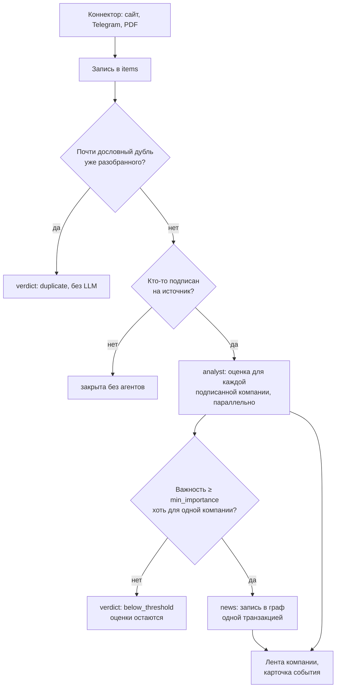

# Архитектура

Как EventGraph превращает поток новостей в персональные выводы для компании:
из каких частей он состоит, как идёт запись от источника до карточки в
ленте, что делают агенты и как обеспечены трассируемость и безопасность.

- [Части сервиса](#части-сервиса)
- [Путь записи](#путь-записи)
- [Агенты](#агенты)
- [Граф событий](#граф-событий)
- [Профиль компании](#профиль-компании)
- [Источники](#источники)
- [Хранилище](#хранилище)
- [Трассируемость](#трассируемость)
- [Безопасность](#безопасность)
- [Масштабирование](#масштабирование)
- [Карта кода](#карта-кода)

## Части сервиса

| часть | что делает |
|---|---|
| **Интерфейс** (`gui/`) | прототип «Альфа-Бизнеса» на стандартном `http.server` Python: лента, карточки, граф, профиль, чат онбординга, настройки. В API ходит со стороны сервера с ключом `X-Api-Key` — браузер ключа не видит |
| **API** (`eventgraph/main.py`, `eventgraph/api/`) | FastAPI: источники, записи, граф, раны агентов, профили, лента компании, AI-чаты и сводки. В граф через API не пишут |
| **Воркер** (`eventgraph/worker.py`) | коннекторы по расписанию; очередь разбора: аналитик и `news` по одной записи; садовник по сроку; загрузка базового графа, профилей-примеров и профилей из `PROFILES_DIR` |
| **Онбординг** (`profile/`) | агент «Добавить компанию»: разбор документов (docling), фильтр чувствительных данных, вопросы, сборка страничного профиля |
| **Postgres + pgvector** | одна база на записи, граф, раны, профили, библиотеку компаний и векторы |
| **SearXNG** | метапоисковик для `web_search` агентов (`search_tool/`) |
| **Langfuse** (необязательно) | трассировка всех вызовов модели и инструментов |

## Путь записи

1. **Сбор.** Коннектор забирает новые материалы по своему курсору и
   расписанию и кладёт их в `items`. Первый запуск забирает по 10 последних.
2. **Сюжеты и дубли.** Записи об одном событии объединяются в сюжет (по
   сходству векторов в окне `STORY_WINDOW_HOURS`): агенту видно, в какие
   события графа уже разобраны другие записи сюжета. Почти дословный повтор
   уже разобранного (`DUPLICATE_THRESHOLD`) закрывается без LLM.
3. **Оценка.** Агент `analyst` оценивает запись для каждой компании,
   подписанной на её источник: до `ANALYST_CONCURRENCY` ранов одновременно.
   Сбой аналитика разбор не останавливает: запись идёт дальше без оценки, а
   повторная попытка оценивает её только для тех, у кого оценки нет.
4. **Порог.** Запись ниже `min_importance` для всех компаний закрывается
   вердиктом `below_threshold` и в граф не попадает. Важная хоть одной
   компании идёт в общий граф. Снизили порог или добавили компанию —
   `POST /graph/requeue-below-threshold` вернёт такие записи в очередь.
5. **Граф.** Агент `news` разбирает запись в события, организации, людей,
   места и связи и пишет их одной транзакцией. Раны записи идут строго по
   одному: две записи об одном событии, разобранные параллельно, дали бы два
   узла-дубля.
6. **Лента.** `GET /profiles/{id}/feed` отдаёт записи с оценками компании;
   интерфейс дополняет карточку фрагментами аналитики банка и событием графа.

Если модель не отвечает, разбор встаёт на паузу: 30 с, дальше вдвое, до
15 минут; первый удачный ран её снимает. Новая запись уходит в разбор через
пару секунд после сбора.

## Агенты

Каждый агент — ReAct-цикл (`eventgraph/agents/runner.py`): модель сама
решает, какой инструмент вызвать, видит ответы прошлых шагов и
останавливается, когда готов итог. Права и потолки заданы в коде
(`eventgraph/agents/specs.py`), промпты — в `prompts/*.md`.

| агент | когда работает | что делает | граф | веб | шагов |
|---|---|---|---|---|---|
| `analyst` | на каждую запись, для каждой компании | важность 0–5 для компании, механизм влияния, риск или возможность, горизонт, тренд по графу, связанные события, шаги | чтение | да | 30 |
| `news` | на каждую запись выше порога | события, участники, издания и связи; вердикт по записи | чтение, запись | да | 100 |
| `gardener` | раз в `maintenance_every_days` дней, между записями | дубли, островки, обрезка графа; решения о слиянии — в журнал | чтение, запись, удаление, обслуживание | — | 60 |
| `summarizer` | кнопка «Суммаризировать» | сводка по ленте с фильтрами | — | — | 1 |
| `news_chat` | чат в карточке события | ответы по новости с профилем компании | чтение | — | 5 |
| `graph_chat` | чат по графу | актуальные события, противоречия, связанные узлы | чтение | — | 8 |
| онбординг | «Добавить компанию» | вопросы и страницы профиля по анкете, документам и данным банка | — | — | — |

### Оценка аналитика

Итог аналитика — JSON по схеме, он хранится в
`items.analysis.profiles[profile_id]`:

| поле | значения |
|---|---|
| `importance` | 0–5, для компании, а не для мира |
| `impact` | механизм влияния на бизнес |
| `relevance` | `direct` — названы компания, её продукты, клиенты, конкуренты, регуляторы · `indirect` — её рынок, отрасль, регион · `none` |
| `direction` | `risk` · `opportunity` · `mixed` · `neutral` |
| `horizon` | `immediate` · `weeks` · `months` · `years` |
| `trend` | относительно графа: `new` · `continues` · `escalates` · `eases` |
| `areas`, `entities` | затронутые направления бизнеса и участники |
| `related_events` | точные имена узлов графа, которые агент действительно видел |
| `actions` | что можно сделать |
| `confidence`, `headline` | уверенность и заголовок для компании |
| `run_id` | ран, который сделал оценку |

Глубину поиска аналитик выбирает по значимости: запись, не касающуюся
компании, он закрывает сразу, без поиска. Без валидного JSON оценка не
сохраняется, и запись оценивается заново при следующей попытке.

### Инструменты

| группа | инструменты |
|---|---|
| граф | `graph_search`, `graph_node`, `graph_neighbors`, `graph_period`; у `news` — `graph_upsert`; у садовника — инструменты обслуживания и `graph_prune` (сначала вхолостую) |
| профиль | `profile_search(query, mode)` — `keyword`, `vector` или `hybrid` (слияние рангов RRF); `profile_page(page_id, offset)` — страница окнами по 6000 знаков |
| веб | `web_search(query, category, time_range, domains)` — SearXNG, 5 страниц, с каждой 2 ближайших по смыслу фрагмента; `web_page(source_id, offset)` — дочитать страницу |
| картинки | `view_image` |

Инструменты профиля привязаны к `profile_id` рана — агент не может прочитать
чужой профиль. `RepeatGuard` не даёт зациклиться на одном вызове.

## Граф событий

- Узлы находятся по имени, рёбра — по четвёрке (откуда, куда, тип, граф);
  повтор не создаёт дубль.
- Типы узлов: события, организации, люди, места, темы, издания, прочее.
  У узла — метаданные (дата, важность, роль, сводка, другие названия) и
  элементы: публикации-первоисточники.
- Поиск по смыслу — векторы pgvector; длинные метаданные (сводка события,
  цитата публикации) получают свой вектор. Тексты публикаций эмбеддятся как
  есть, без суммаризации моделью: запись в граф не тратит токены.
- **Базовый граф.** Снимок новостного графа на 21.10.2026
  (`eventgraph/seed/news-graph.json.gz`: 2270 узлов, 6265 связей) с готовыми
  векторами (`eventgraph/seed/embeddings.npz`) вливается при первом старте —
  аналитик с первого дня сверяет записи с прошлыми событиями.
- **Садовник** по расписанию сливает дубли, убирает островки и лишнее;
  решения пишутся в журнал (`GET /graph/maintenance/{id}`).

## Профиль компании

Профиль — страничный документ (`profile/contract.py`, `ProfileDocument`,
`schema_version=2`):

- **«Основное»** (`main`, до 4000 знаков) — аналитик видит всегда, вместе с
  оглавлением остальных страниц;
- **аналитические страницы** — продукты, контрагенты, финансы, риски;
- **полный текст** каждого приложенного файла (`file-N`), **поля набора
  банка** (`dataset`), **анкета с ответами** (`dialog`).

Фрагменты страниц лежат в `profile_chunks` с вектором и полнотекстовым
индексом (русская морфология). Утверждения ссылаются на источник:
`form.*`, `answer.N`, `file:<id>:<стр.>`, `dataset.*`, `signals.payments`.
Агент онбординга отклоняет ссылки на несуществующие источники и просит
модель исправить ответ.

Профиль попадает в EventGraph через `PUT /profiles` (так делает интерфейс
после подтверждения) или файлом в `PROFILES_DIR`. Текст для промпта
(`render_for_prompt`) хранится в `company_profiles.prompt`. Компания с
выбранными источниками (`news_sources`) получает оценки только по ним.

## Источники

| имя | что | вид |
|---|---|---|
| `lenta_economics` | Lenta.ru — новости экономики (RSS), раз в 30 минут | `website` |
| `alfa_investments` | Telegram-канал Альфа-Инвестиций `@alfa_investments` | `telegram_channel` |
| `alfa_analytics` | PDF-отчёты аналитиков банка (приложение 2 и каталог `./pdfs`); запись — страница отчёта | `pdf` |
| `alfa_investor_site` | Альфа-Инвестор на alfabank.ru — **выключен**: сайт закрыт защитой от ботов | `website` |

Виды сборщиков — модули `eventgraph/connectors/kinds/`:

- `website` — раздел сайта: RSS, затем sitemap, затем листинг; robots.txt
  соблюдается;
- `telegram_channel` — публичный канал через `t.me/s/<канал>`;
- `pdf` — каталог или ссылки на PDF, разбор docling с общим кэшем.

Встроенные источники — строки в `eventgraph/sources.py`. Пользователь
добавляет свои сайты и Telegram-каналы из интерфейса — это настройки
существующих сборщиков, не код. Новый вид источника — модуль с функцией
`collect`. У коннектора в базе — курсор, расписание и история запусков.

## Хранилище

Одна база Postgres с pgvector:

| таблица или схема | что |
|---|---|
| `items` | собранные записи: текст, источник, сюжет, вердикт, `analysis` с оценками компаний |
| `graph_elements`, `graph_items`, `graph_merge_decisions` | граф: узлы и рёбра с векторами, их элементы (публикации), журнал решений о слиянии |
| `maintenance_runs`, `maintenance_tasks` | прогоны садовника и их задачи |
| `agent_runs`, `agent_logs` | раны агентов и каждый их шаг |
| `connectors`, `connector_runs` | состояние источников и их запуски |
| `company_profiles`, `profile_chunks` | профили компаний и их фрагменты |
| `ai_summaries`, `ai_chats` | сводки и чаты из интерфейса |
| `app_settings` | настройки разбора и отметки загрузки базового графа |
| схема `profile_data` | библиотека компаний приложения 1 и аналитика банка для онбординга |

## Трассируемость

Каждый вывод можно восстановить до источников:

| что | где |
|---|---|
| ран агента: вход (запись и профиль), итог, шаги, токены, время | `agent_runs` · `GET /agent-runs/{id}` |
| каждый шаг: рассуждение, вызов инструмента с аргументами и полным ответом, ошибка | `agent_logs` · там же |
| оценка записи для компании и ран, который её сделал | `items.analysis.profiles[profile_id].run_id` · `GET /graph/processed` |
| событие графа и его публикации | `GET /graphs/{graph}/nodes?name=` · вкладка «Граф событий» |
| признаки компании, на которых основан профиль | ссылки страниц профиля |
| по каким записям собрана сводка | `ai_summaries.source_uids` |
| проход онбординга: сообщения, запросы и ответы LLM, обращения к базе | `GUI_RUNS_DIR/<id>/trace.jsonl` |
| все вызовы модели и инструментов деревом | Langfuse |

В интерфейсе происхождение разведено метками: `AI` — выводы модели,
`Альфа-Банк` — фрагменты отчётов банка, `Источник` — первоисточник.

## Безопасность

- **Права агентов** заданы в коде и определяют, какие инструменты агент
  получает: аналитик и чаты только читают граф, пишет `news`, удаляет и
  сливает только садовник. Агенты не исполняют код и не ходят в
  произвольные системы.
- **Доступ.** Все методы API, кроме `/health`, требуют `X-Api-Key`
  (сравнение за постоянное время); без `API_KEY` API закрыт. Интерфейс — по
  ключу доступа из 40 символов, после входа — HttpOnly-кука; ключ LLM
  хранится с правами `0600` и в браузер не отдаётся.
- **Чувствительные данные в документах** (`profile/sensitive.py`). Текст
  проверяется сразу после разбора файла — до векторов, LLM, страниц профиля
  и журнала. Правила — регулярные выражения с контрольными суммами (Luhn,
  СНИЛС, ИНН-12) и обязательным контекстом («паспорт», «р/с»), чтобы не
  задевать числа в финансовых таблицах. Секреты (карты, CVV, пароли, ключи)
  вырезаются всегда; персональные и коммерческие данные скрыты по умолчанию,
  и решение принимает пользователь. Исходный файл после разбора удаляется,
  в профиле остаются sha256 и счётчик скрытого.
- **Данные банка.** В LLM при черновике профиля уходят только агрегаты
  связей по платежам, без ID и сумм отдельных платежей.
- **Недоверенный контент.** Страницы веб-поиска помечены для агента как
  данные, а не инструкции; даже если текст новости попытается управлять
  агентом, набор его инструментов от этого не расширяется. Коннекторы
  соблюдают robots.txt и не обходят защиту сайтов.
- **Ограничения.** Потолки шагов, таймауты модели, инструмента и рана,
  остановка рана (`POST /agent-runs/{id}/stop`), пауза разбора
  (`PUT /graph/settings`, `enabled: false`), запись в граф одной
  транзакцией.

## Масштабирование

- **Новые клиенты и отрасли** не требуют кода: отрасль задаётся профилем, а
  не правилами.
- **Новые материалы банка** — PDF в `./pdfs`.
- **Нагрузка.** Оценки разных компаний по одной записи идут параллельно;
  запись в граф — строго по одной. Порог важности и подписка на источники
  ограничивают число ранов на компанию. Следующий шаг — несколько воркеров
  аналитика по очереди профилей при одном писателе графа и отдельная база для
  `profile_data`.
- **Отличия стенда от промышленного контура:** нет входа через
  интернет-банк и ролей (один общий ключ), один воркер, одна база, данные
  клиентов — обезличенный набор кейса.

## Карта кода

| часть | где |
|---|---|
| сборщики источников, лента, сюжеты, воркер, API | `eventgraph/connectors/`, `sources.py`, `news.py`, `stories.py`, `worker.py`, `api/` |
| ReAct-цикл, повторы, картинки, учёт токенов | `eventgraph/agents/runner.py`, `agents/images.py` |
| агенты и промпты | `eventgraph/agents/specs.py`, `prompts/*.md` |
| инструменты агентов | `eventgraph/agents/tools.py`, `agents/web.py`, `graph/upkeep.py`, `search_tool/` |
| граф: хранение, поиск, слияние дублей | `eventgraph/graph/store.py`, `graph/merge.py`, `embed.py` |
| профиль компании и онбординг | `profile/` |
| интерфейс | `gui/` |
| трассировка Langfuse | `utils/tracing.py` |
| тесты | `tests/` |
