# Руководство пользователя

Интерфейс EventGraph — прототип раздела «Бизнес-аналитика» интернет-банка
«Альфа-Бизнес». Он показывает руководителю компании новости рынка, отобранные
и разобранные под его бизнес, с позицией аналитиков банка и выводами AI.

Скриншоты сняты на тестовом стенде 25.10.2026 с профилями-примерами из
поставки и базовым графом событий.

- [Вход](#вход)
- [Устройство экрана и выбор компании](#устройство-экрана-и-выбор-компании)
- [Главная](#главная)
- [Бизнес-аналитика: лента](#бизнес-аналитика-лента)
- [Карточка события](#карточка-события)
- [Фильтры, сводка и чаты с AI](#фильтры-сводка-и-чаты-с-ai)
- [Источники новостей](#источники-новостей)
- [Граф событий](#граф-событий)
- [Профиль компании](#профиль-компании)
- [Добавление компании](#добавление-компании)
- [Настройки модели и выход](#настройки-модели-и-выход)

## Вход

Интерфейс открывается по адресу `http://<сервер>:8765` и пускает только по
ключу доступа — строке из 40 символов, которую выдаёт администратор стенда
(см. [«Развёртывание»](deployment.md#ключ-доступа-к-интерфейсу)).

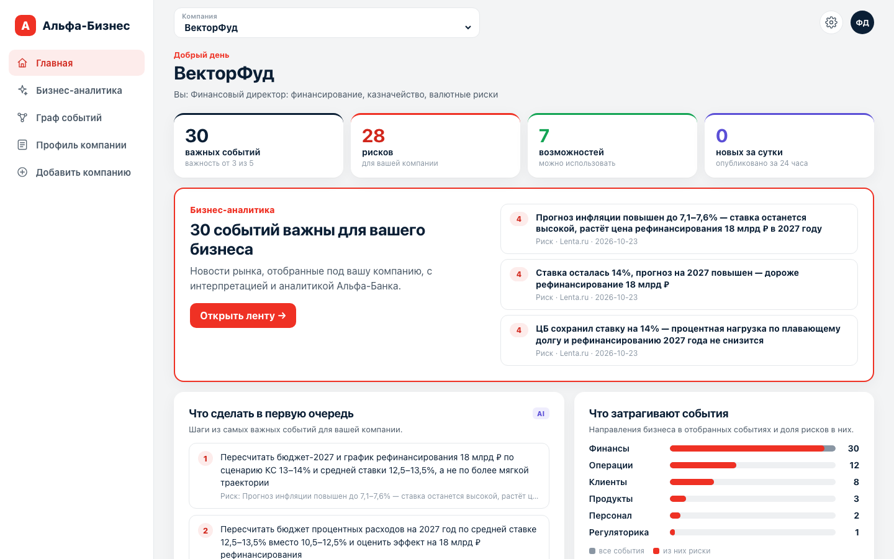

После входа браузер помнит сессию 30 дней. Если администратор сменит ключ,
войти придётся заново всем пользователям.

## Устройство экрана и выбор компании

Слева — меню разделов: **Главная**, **Бизнес-аналитика**, **Граф событий**,
**Профиль компании**, **Добавить компанию**. Сверху — переключатель
**«Компания»**, шестерёнка настроек и аватар пользователя.

На стенде нет входа клиента через интернет-банк, поэтому переключатель
заменяет его: выберите компанию — и все разделы покажут данные глазами её
руководителя. В поставке 10 профилей-примеров: демо-компании **ВекторФуд**
(молочное производство) и **СибМеталл** (металлургия) и восемь компаний из
обезличенного набора банка — топливный трейдер, тепловая генерация,
девелопер, зерновой экспортёр и другие. Добавленные вами компании появляются
в этом же списке.

## Главная

Точка входа в бизнес-аналитику. Всё на странице считается по ленте выбранной
компании с текущим порогом важности (по умолчанию — от 3 из 5).

- **Счётчики** — сколько важных событий, из них рисков и возможностей, и
  сколько опубликовано за последние сутки.
- **Баннер «Бизнес-аналитика»** — три самых важных события с оценкой
  важности; клик открывает событие в ленте, кнопка «Открыть ленту» — всю ленту.
- **«Что сделать в первую очередь»** (`AI`) — первые рекомендованные шаги из
  самых важных событий со ссылкой на событие, из которого шаг взят.
- **«Что затрагивают события»** — какие направления бизнеса (финансы,
  операции, клиенты, продукты…) чаще всего затронуты и какая доля из этого —
  риски.
- **Карточки разделов** — профиль компании (сколько страниц и когда обновлён),
  источники новостей с состоянием последнего сбора, граф событий и
  добавление компании.

## Бизнес-аналитика: лента

Раздел **«Бизнес-аналитика»** → вкладка **«Лента»** — новости, которые агент
`analyst` оценил для выбранной компании.

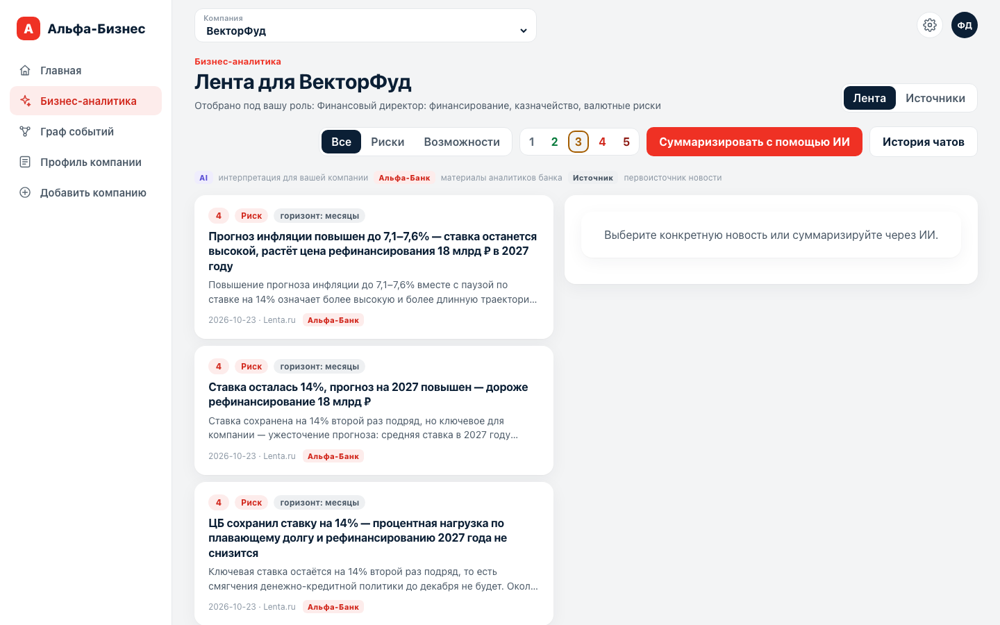

Каждая карточка ленты содержит:

| элемент | что значит |
|---|---|
| число в кружке | важность для этой компании, от 0 до 5 (не для рынка в целом) |
| **Риск** / **Возможность** / **Риск и возможность** / **Нейтрально** | направление влияния на бизнес |
| **горизонт** | когда скажется: сразу, недели, месяцы, годы |
| заголовок | формулировка события для компании, а не заголовок СМИ |
| текст | начало объяснения механизма влияния |
| дата, источник | когда и где опубликовано |
| метка **Альфа-Банк** | к событию нашлись материалы аналитиков банка |

Над лентой — легенда цветных меток. Она же используется в карточке события:

- `AI` — интерпретация для вашей компании, её написала модель;
- `Альфа-Банк` — фрагменты отчётов аналитиков банка;
- `Источник` — первоисточник новости.

### Одна новость — разные оценки

Оценка строится по профилю компании, поэтому одно и то же событие у разных
клиентов выглядит по-разному. Решение ЦБ сохранить ставку 14% для ВекторФуда
(70% долга под плавающую ставку, рефинансирование 18 млрд ₽ в 2027 году) —
важность 4 и риск. У СибМеталла та же новость сформулирована через его
11 млрд ₽ плавающего долга; у тепловой генерации на первом месте рост цен на
нефть, а ставка — важность 3.

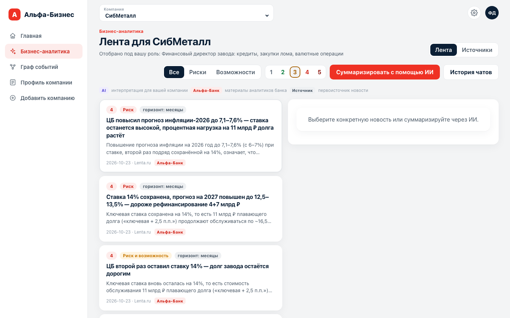

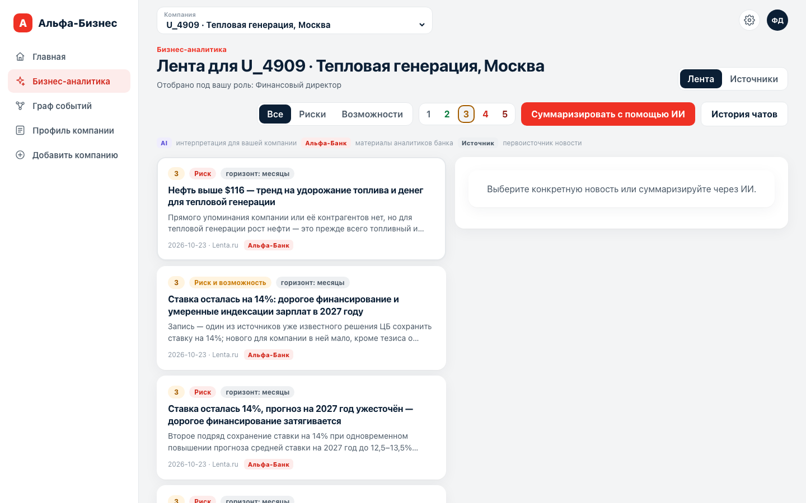

## Карточка события

Клик по карточке ленты открывает справа полную карточку события. Её блоки
разведены по происхождению: что сказала модель, что пишет банк, что было в
первоисточнике.

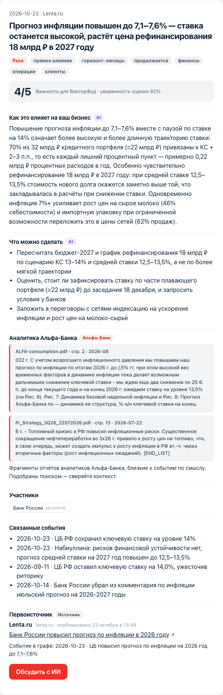

1. **Шапка** — дата, источник, заголовок; метки направления, типа влияния
   (прямое или косвенное), горизонта, тренда относительно прошлых событий
   графа (новое, продолжается, усиливается, ослабевает) и затронутых
   направлений бизнеса.
2. **Важность** — `4/5` для этой компании и уверенность аналитика в оценке.
3. **«Как это влияет на ваш бизнес»** (`AI`) — механизм влияния с цифрами из
   профиля: какая доля долга под плавающей ставкой, сколько стоит лишний
   процентный пункт, что дорожает в себестоимости.
4. **«Что можно сделать»** (`AI`) — конкретные шаги для руководителя.
5. **«Аналитика Альфа-Банка»** (`Альфа-Банк`) — фрагменты PDF-отчётов
   аналитиков банка, близкие к событию по смыслу, с файлом, страницей и
   датой отчёта. Старые отчёты помечены как исторические. Фрагменты подобраны
   поиском — сверяйте их контекст.
6. **«Участники»** — организации и люди события из графа, с ролью.
7. **«Связанные события»** — прошлые события графа, с которыми аналитик
   связал новость: так видно, тренд это или разовое событие.
8. **«Первоисточник»** (`Источник`) — издание, время публикации, ссылка на
   оригинал и событие, в которое новость записана в графе.
9. Кнопка **«Обсудить с ИИ»** — открывает чат по этой новости.

## Фильтры, сводка и чаты с AI

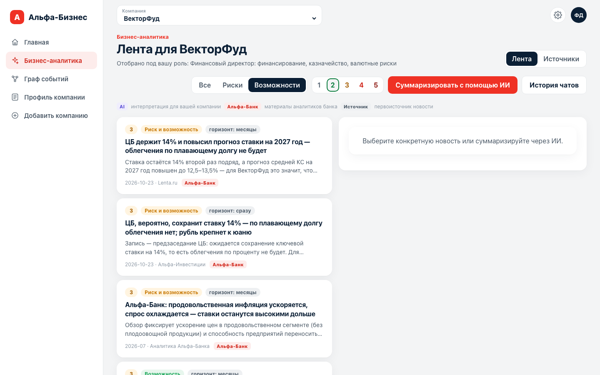

- **«Все / Риски / Возможности»** — направление влияния. События «риск и
  возможность» попадают в оба фильтра.
- **1–5** — минимальная важность. На скриншоте выбраны возможности от 2.
  Порог влияет и на счётчики главной.
- **«Суммаризировать с помощью ИИ»** — агент `summarizer` собирает сводку по
  текущим фильтрам и 15 самым свежим новостям ленты: общая картина, главные
  риски и возможности, практические выводы со ссылкой на заголовки событий. Сводка сохраняется и показывается снова при
  тех же фильтрах; видно, по скольким новостям она собрана и когда
  обновлена.
- **«Обсудить с ИИ»** в карточке события — чат по новости (агент `news_chat`).
  Агент знает профиль компании и ищет по графу событий, поэтому на вопрос
  «как это повлияет на наши кредиты?» отвечает с цифрами компании и прошлыми
  событиями. Кнопка «Вернуться к новости» закрывает чат.
- **«История чатов»** — все сохранённые обсуждения выбранной компании с
  числом сообщений и датой; клик продолжает разговор.

> Сводка и чаты вызывают модель, поэтому работают только с заданным ключом
> LLM (см. [«Настройки модели»](#настройки-модели-и-выход)). Без ключа лента,
> карточки и граф доступны, а кнопки AI вернут ошибку.

## Источники новостей

Вкладка **«Бизнес-аналитика → Источники»** — откуда собирается лента
выбранной компании.

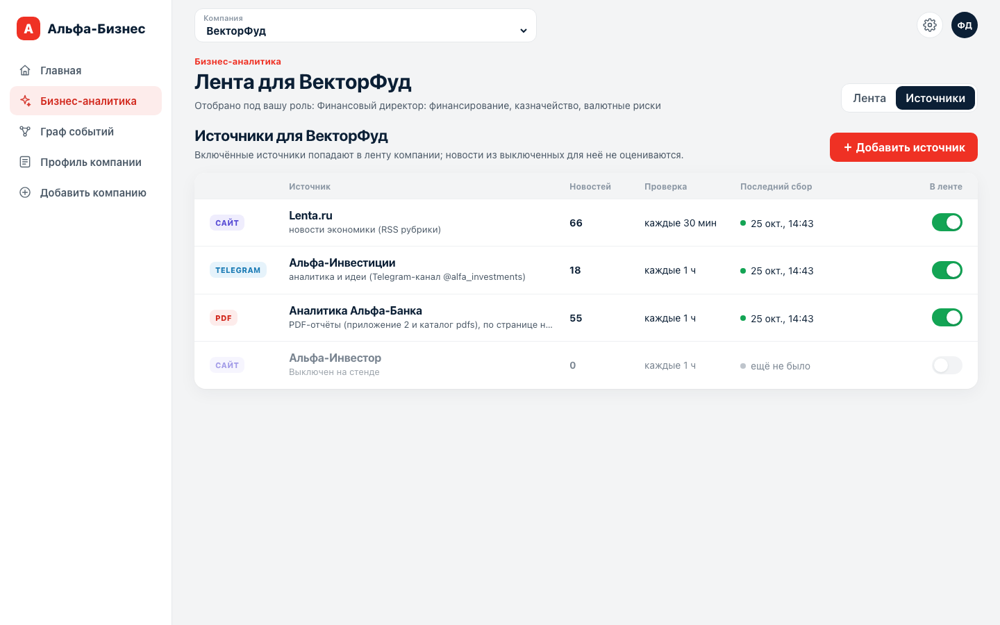

| колонка | что значит |
|---|---|
| тип | `Сайт`, `Telegram` или `PDF` |
| Источник | название и что именно собирается |
| Новостей | сколько записей источник уже собрал |
| Проверка | как часто источник опрашивается |
| Последний сбор | время и состояние: зелёная точка — успешно, красная — ошибка (текст ошибки — под строкой), серая — ещё не запускался |
| В ленте | подписана ли компания на источник |

Встроенные источники стенда:

- **Lenta.ru** — новости экономики (RSS рубрики), каждые 30 минут;
- **Альфа-Инвестиции** — Telegram-канал `@alfa_investments`;
- **Аналитика Альфа-Банка** — PDF-отчёты аналитиков банка; запись — страница
  отчёта;
- **Альфа-Инвестор** — выключен на стенде: сайт закрыт защитой от ботов, а
  обходить её сервис не стал.

Переключатель **«В ленте»** включает и выключает источник для текущей
компании. Новости из выключенного источника для неё не оцениваются — это
экономит вызовы модели. Хотя бы один источник должен остаться включённым.

### Свой источник

Кнопка **«＋ Добавить источник»** открывает форму:

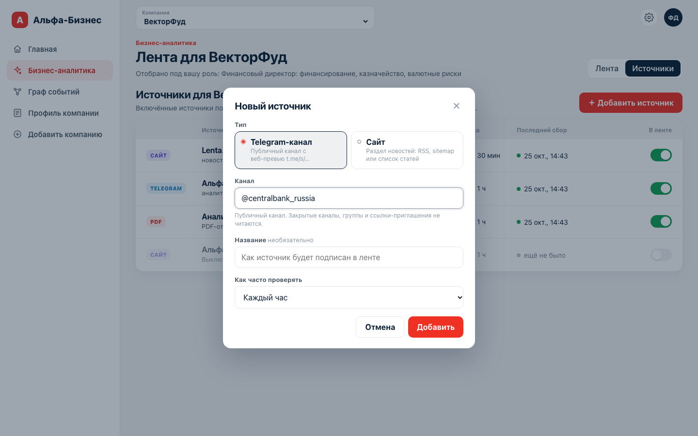

- **Тип** — публичный Telegram-канал (читается через веб-превью
  `t.me/s/…`; закрытые каналы, группы и ссылки-приглашения не читаются) или
  раздел новостей сайта (RSS находится сам; сайты, которые рисуются только
  JavaScript, не читаются).
- **Канал** или **адрес раздела**, необязательное **название** и **частота
  проверки** — от 30 минут до раза в сутки.

Добавленный источник появляется в списке с кнопкой **«Удалить»**. Уже
собранные из него новости после удаления остаются в ленте.

Запустить сбор вне расписания, поставить источник на паузу или сбросить его
курсор можно через API (см. [«API»](api.md#источники)).

## Граф событий

Раздел **«Граф событий»** — общая память сервиса: события из всех
разобранных новостей и их участники. Его пишет агент `news`, а аналитик
сверяет с ним каждую новость.

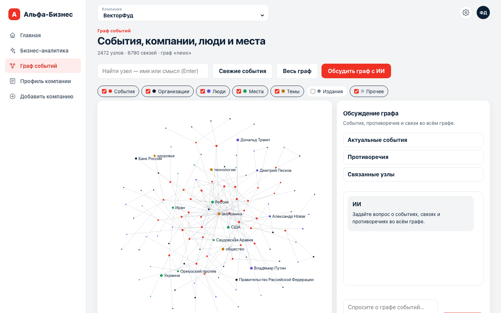

- Над холстом — размер графа (на скриншоте 2472 узла и 6790 связей).
- **Типы узлов** — флажки фильтра: события (красные), организации, люди,
  места, темы, издания, прочее.
- **«Свежие события»** — последние события с соседями (вид по умолчанию),
  **«Весь граф»** — все узлы.
- **Управление холстом:** колесо — масштаб, перетаскивание — сдвиг, клик по
  узлу — подробности, двойной клик — раскрыть его связи.

### Поиск

Поле поиска подсказывает узлы по имени уже при наборе. **Enter** ищет по
смыслу: «рост ставки по кредитам» найдёт события про ключевую ставку, даже
если этих слов в названии нет.

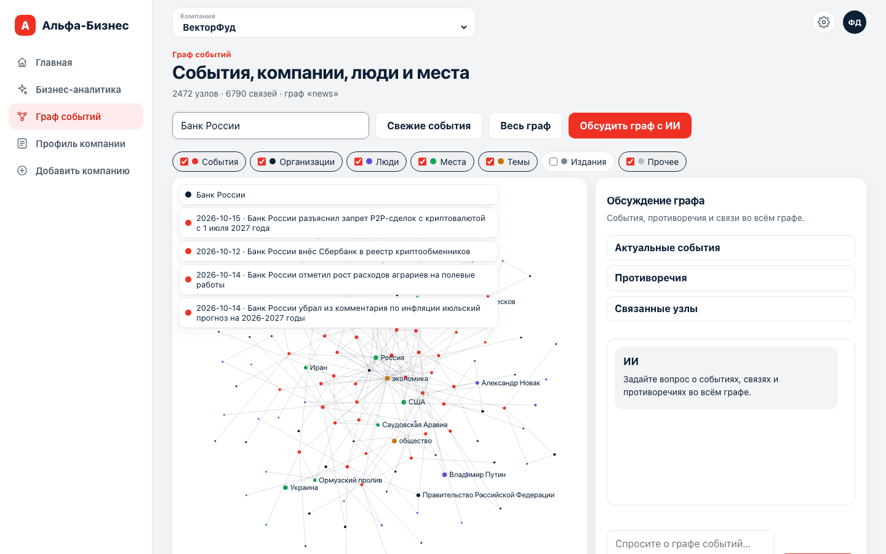

### Подробности узла

Клик по результату или по узлу фокусирует граф на нём и показывает справа
тип, описание, другие названия (например, «ЦБ РФ», «ЦБ»), связи по видам
(«участвует · 28») и публикации — ссылки на первоисточники.

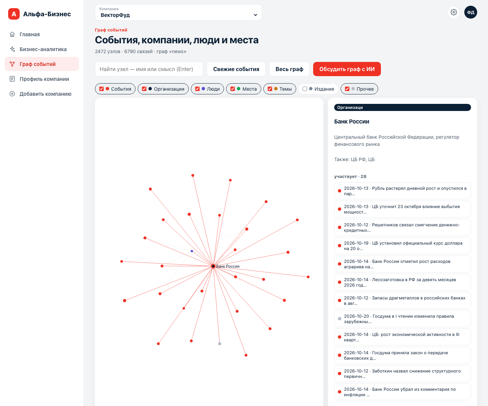

### Обсуждение графа с ИИ

Кнопка **«Обсудить граф с ИИ»** или правая панель без выбранного узла —
чат по всему графу (агент `graph_chat`). Готовые вопросы: **«Актуальные
события»**, **«Противоречия»** (где источники расходятся), **«Связанные
узлы»** (у каких узлов больше всего событий). Можно задать и свой вопрос.
Требует ключа LLM.

## Профиль компании

Раздел **«Профиль компании»** — что аналитик знает о выбранной компании.
По профилю он решает, важна ли новость и как она влияет на бизнес.

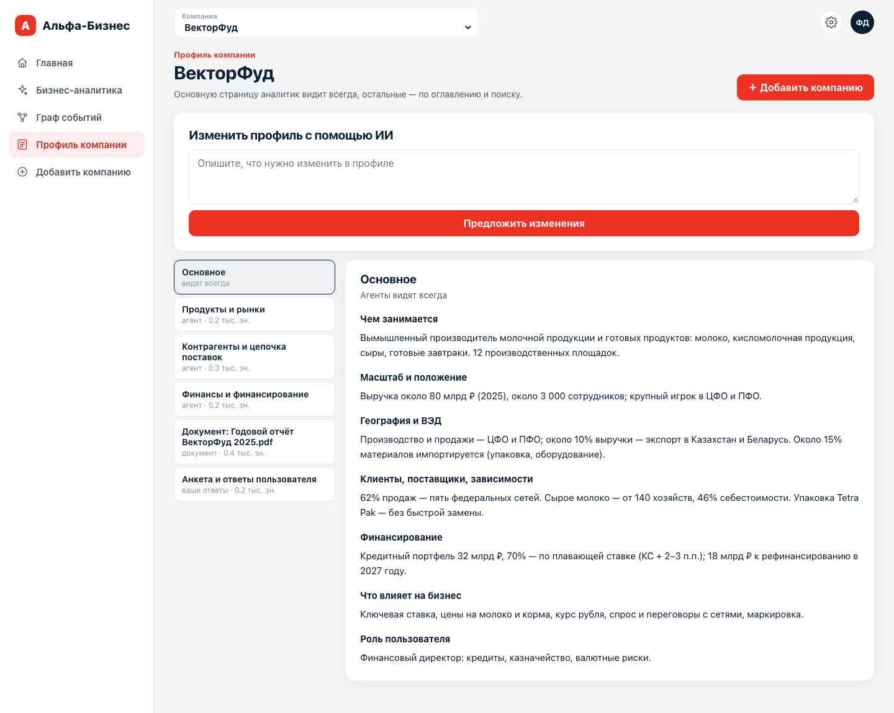

- **«Основное»** — главная страница, до 4000 знаков: чем занимается компания,
  масштаб, география и ВЭД, клиенты и поставщики, финансирование, что влияет
  на бизнес, роль пользователя. Аналитик видит её всегда.
- **Остальные страницы** — аналитические (продукты и рынки, контрагенты,
  финансы), полный текст приложенных документов, данные набора банка, анкета
  и ответы. Аналитик читает их по оглавлению и поиском, когда новость
  касается этой темы. Под названием страницы — кто её написал (агент,
  документ, ваши ответы) и объём.
- Утверждения профиля ссылаются на источник: поле набора банка
  (`dataset.*`), анкету (`form.*`), ответ на вопрос (`answer.N`) или страницу
  документа (`file:<id>:<стр.>`).

### Изменить профиль с помощью ИИ

В поле **«Изменить профиль с помощью ИИ»** опишите, что поменялось, например
«рефинансирование 18 млрд ₽ перенесли на 2028 год», и нажмите **«Предложить
изменения»**. Агент подготовит черновик точечных правок и покажет построчный
diff по страницам: добавленные строки — `+`, удалённые — `−`. Ничего не
сохраняется, пока вы не нажмёте **«Подтвердить и сохранить»**; **«Отменить»**
отбрасывает черновик. Требует ключа LLM.

## Добавление компании

Раздел **«Добавить компанию»** — чат с агентом онбординга. За несколько минут
он собирает профиль новой компании из данных банка, анкеты и документов.
Пошаговый сценарий с готовыми ответами и файлами —
[demo-company](demo-company/README.md); скриншоты ниже сняты по нему.

### 1. Компания из набора банка

В поле **«Компания»** введите название или ID из набора банка (`U_…`) и
выберите подсказку. Чат подтянет карточку компании (ОКВЭД, выручку, регион,
продукты банка) и агрегаты связей по платежам. Если компании в наборе нет,
просто впишите название.

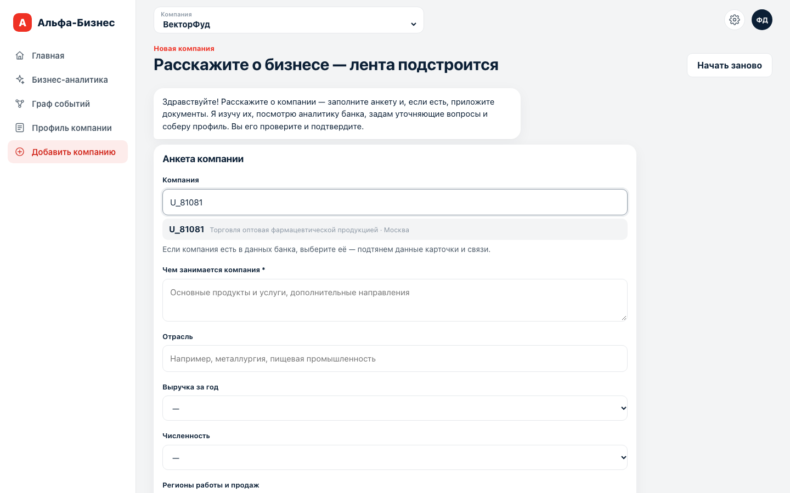

### 2. Анкета и документы

Обязательные поля — **«Чем занимается компания»** и **«Ваша роль»**.
Остальные помогают агенту: отрасль, выручка, численность, регионы, внешняя
торговля, ключевые клиенты и поставщики, что сильнее всего влияет на бизнес,
какие решения вы принимаете, что ещё важно знать.

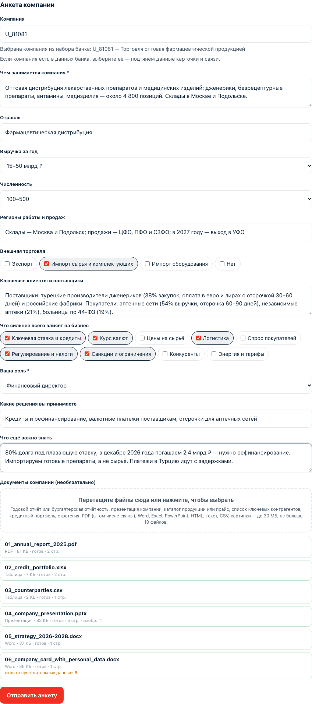

В область **«Документы компании»** перетащите файлы или нажмите на неё:
годовой отчёт, презентация, кредитный портфель, список контрагентов,
стратегия. Поддерживаются PDF (в том числе сканы — их распознаёт OCR),
Word, Excel, PowerPoint, HTML, CSV, текст и картинки; до 30 МБ каждый и не
больше 10 файлов. У каждого файла виден статус разбора, число страниц и
картинок и сколько чувствительных данных в нём скрыто.

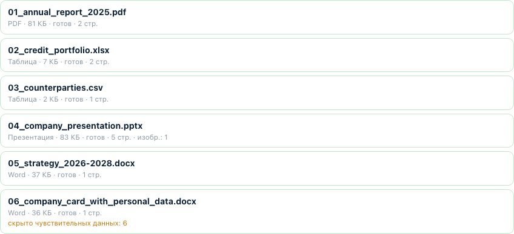

Загружайте файлы по одному или дожидайтесь статуса «готов»: разбор
документов требует памяти, а первый разбор ещё и скачивает модели.

### 3. Персональные данные в документах

После **«Отправить анкету»** чат пишет, что прочитал в каждом файле, и
проверяет текст фильтром чувствительных данных — до того, как его увидит
модель. Если нашлись паспорт, СНИЛС, ИНН физлица, телефон, e-mail, дата
рождения, номер счёта или пометка о конфиденциальности, чат покажет, что и
где найдено (превью замаскированы, самих значений в браузере нет), и
спросит, как поступить:

- **«Скрыть найденное (рекомендуется)»** — в профиле вместо значений будут
  метки `[паспорт]`, `[телефон]`, `[счёт]` и т. п.;
- **«Оставить как есть»**;
- **«Убрать эти файлы»**.

Номера карт, CVV, пароли и ключи скрываются при любом ответе. ИНН, ОГРН и
КПП юрлица остаются — это публичные данные компании. Если модель видит
картинки, чат отдельно предупредит: данные на картинках автоматически не
скрываются.

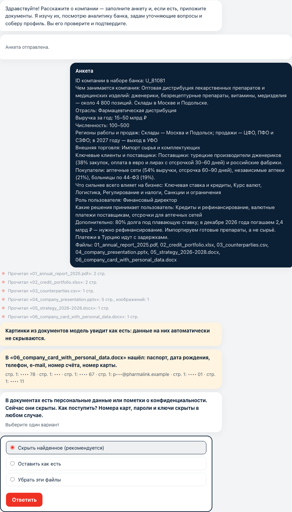

### 4. Вопросы агента

Агент читает документы, данные банка и анкету и задаёт до пяти уточняющих
вопросов — только о том, чего в них нет. Ответ — один вариант, несколько
вариантов, свой текст или «Не знаю». Пока агент работает, в чате видно, что
он делает.

### 5. Проверка и подтверждение профиля

Агент собирает страницы профиля со ссылками на источники. Пролистайте их,
любую страницу можно поправить кнопкой **«Редактировать»** (у «Основного» —
счётчик лимита 4000 знаков). **«Подтвердить профиль»** сохраняет его, и
компания сразу появляется в переключателе компаний.

### 6. Источники новостей

Последний шаг — отметить источники, по которым компании собирать ленту, и
нажать **«Сохранить источники»**.

Аналитик оценивает для новой компании записи, собранные **после** её
добавления. Первые оценки появятся в ленте через несколько минут — по мере
сбора новостей. Кнопка **«Начать заново»** сбрасывает текущий диалог.

## Настройки модели и выход

Шестерёнка справа вверху открывает настройки модели, которой пользуются все
агенты, чаты, сводки и мастер профиля.

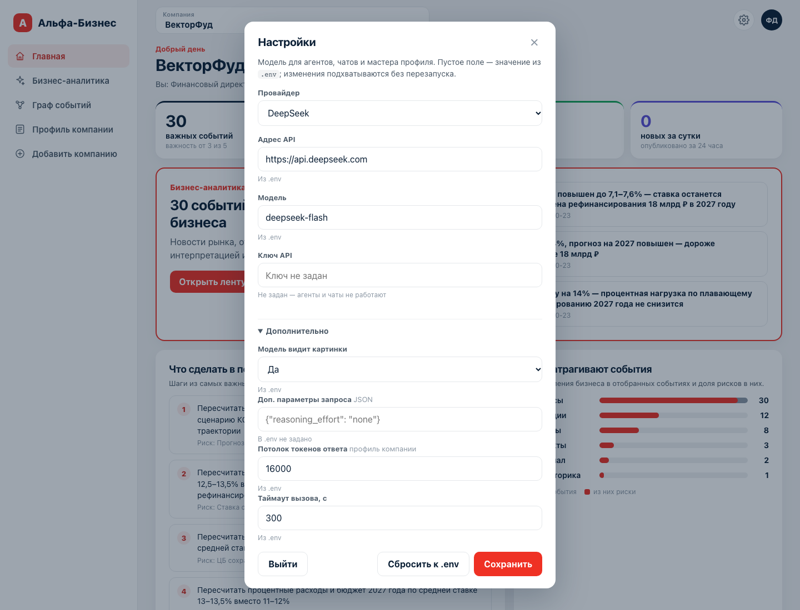

- **Провайдер** — DeepSeek, OpenAI, OpenRouter или любой OpenAI-совместимый
  API; выбор подставляет адрес API и модель по умолчанию.
- **Адрес API**, **Модель**, **Ключ API**. Под каждым полем видно, откуда
  взято значение: «Из .env» или «Задано здесь». Ключ в браузер не
  возвращается — показываются только его последние символы; «Не задан —
  агенты и чаты не работают» значит, что AI-функции выключены.
- **«Дополнительно»:** видит ли модель картинки, доп. параметры запроса
  (JSON, например `{"reasoning_effort": "none"}`), потолок токенов ответа
  для мастера профиля, таймаут вызова.
- **«Сохранить»** — изменения применяются без перезапуска во всех сервисах.
  **«Сбросить к .env»** — вернуть значения из файла окружения.
- **«Выйти»** — завершить сессию в этом браузере.
